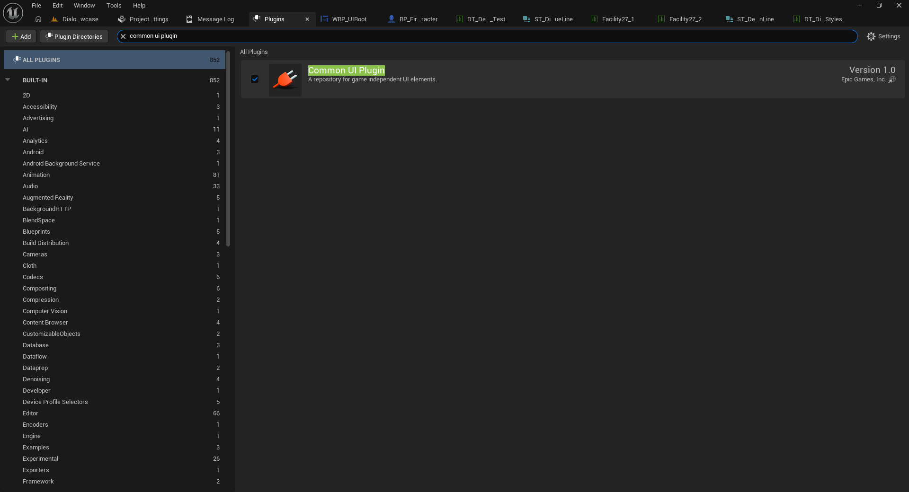
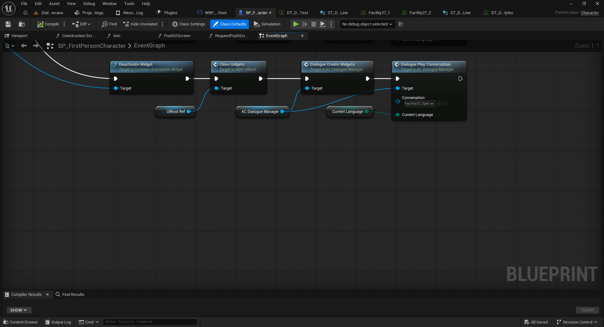
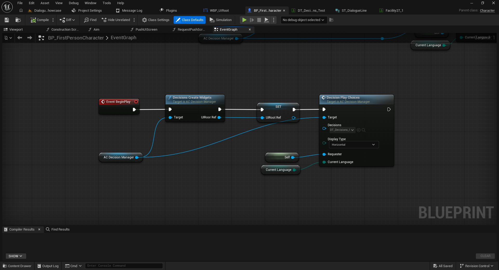

# 01 — Instalación e inicio rápido

[← Volver al índice](../README.md)

## 1. Requisitos

- Unreal Engine 5, versión compatible con la ficha del producto en Fab.
- **Common UI Plugin**, incluido con Unreal Engine 5 y requerido por el sistema de decisiones. Abre **Edit → Plugins**, busca **Common UI**, actívalo y reinicia el editor cuando se solicite.
- Paquete Full instalado. No se requiere C++ ni sustituir `GameInstance`, `GameMode` o `PlayerController`.



## 2. Añadir los dos Actor Components

1. Abre el Blueprint de tu jugador, por ejemplo `BP_FirstPersonCharacter`.
2. En **Components → Add** agrega **`AC_DialogueManager`** (diálogos).
3. Agrega **`AC_DecisionManager`** (decisiones de Common UI).
4. Compila y guarda.

En la demo, el primero se encuentra en `Content/DialogueSystem/Blueprints/Core/AC_DialogueManager` y el segundo en `Content/DialogueSystem/DecisionsSystem/Blueprints/Core/AC_DecisionManager`.


## 3. Iniciar una conversación

1. Arrastra al **Event Graph** una referencia al componente `AC_DialogueManager`.
2. Llama primero a **`Dialogue Create Widgets`**, usando ese componente como `Target`.
3. Después llama a **`Dialogue Play Conversation`** con el mismo `Target`.
4. Elige en `Conversation` la Data Table (`ST_DialogueLine`) y conecta la variable `Current Language` al pin de idioma.

```text
Event BeginPlay (ejemplo de prueba)
    → Dialogue Create Widgets (Target: AC_DialogueManager)
    → Dialogue Play Conversation (Target: AC_DialogueManager,
                                  Conversation: DT_MiConversacion,
                                  Current Language: Current Language)
```



**Nota:** la captura muestra un flujo de la demo en el que se cierran widgets de decisiones antes de abrir de nuevo el diálogo. No es necesario añadir `Deactivate Widget` ni `Close Gidgets` para una primera conversación aislada. En un juego real, llama a la conversación desde una interacción en lugar de `BeginPlay`.

## 4. Iniciar las decisiones

Para una prueba simple, llama a `Decisions Create Widgets` desde `AC_DecisionManager`, guarda `UIRoot Ref` y ejecuta `Decision Play Choices` con tu Data Table, `Requester` y `Current Language`. La configuración detallada se encuentra en [04 — Decisiones](04-decisiones.md).



Siguiente: [Conversaciones](02-conversaciones.md).
