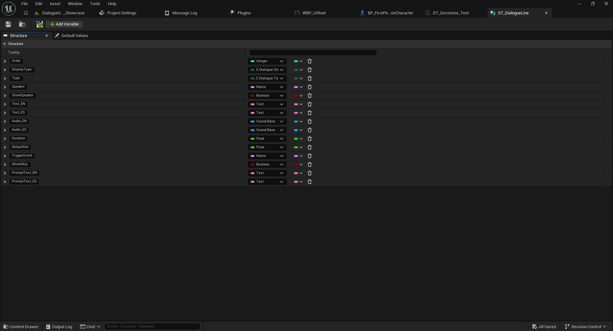
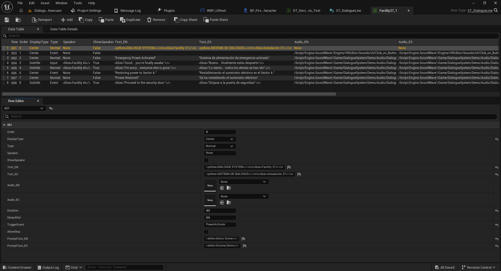

# 02 — Conversaciones y Data Tables

[← Volver al índice](../README.md)

## 1. Crear una Data Table

1. Abre el Content Browser.
2. Clic derecho > **Miscellaneous > Data Table**.
3. Elige `ST_DialogueLine` como estructura.
4. Nombra la tabla, por ejemplo `DT_MiConversacion`.
5. Abre la tabla y agrega filas, una por cada línea o instrucción.

## 2. Configurar las filas

La propiedad `Order` determina el orden de las líneas dentro de la conversación; el `Row Name` identifica cada registro. Usa identificadores claros (`001`, `002`, `003`) y un orden explícito.

| Campo | Uso |
|---|---|
| `Order` | Orden de ejecución de la línea. |
| `DisplayType` | Selección de presentación, como `Subtitle` o `Center`. |
| `Type` | Clasifica la línea (por ejemplo `Normal`, `Event` o `Input` según el enum instalado). |
| `Speaker` | Identificador del personaje. |
| `ShowSpeaker` | Mostrar u ocultar su nombre. |
| `Text_ES` / `Text_EN` | Texto de la conversación por idioma. |
| `Audio_ES` / `Audio_EN` | Voz por idioma cuando corresponda. |
| `Duration` | Duración configurada de la línea. |
| `DelayAfter` | Pausa antes de continuar a la siguiente línea. |
| `TriggerEvent` | Identificador del evento para `BPI_DialogueEvents`. |
| `AllowSkip` | Control de omisión individual, disponible en Full. |
| `PromptText_ES` / `PromptText_EN` | Mensajes contextuales localizados. |

**Nota:** las capturas de la estructura pueden incluir campos adicionales para opciones de color o presentación; conserva sus nombres exactos tal como aparecen en el proyecto Full. No confundas la propiedad `DisplayType` con el tipo de línea.

## 3. Ejemplo sencillo

| Row Name | Order | Speaker | Text_ES |
|---|---:|---|---|
| `001` | 0 | Guía | Bienvenido a las instalaciones. |
| `002` | 1 | Guía | Busca el generador de emergencia. |
| `003` | 2 | Guía | Ten cuidado. |

Para las filas de diálogo normales, elige el valor de `Type` correspondiente a diálogo normal que aparezca en **tu versión instalada** y utiliza `DisplayType = Subtitle` si deseas subtítulos.

## 4. Reproducir una conversación

Con `AC_DialogueManager` en el Player, llama a `Dialogue Create Widgets` y después a `Dialogue Play Conversation`, conectando la Data Table al pin `Conversation`.

## 5. Capturas

Las referencias anteriores apuntan a `images/estructura-dialogue-line.png` y `images/configuracion-data-table.png`. Conserva esos nombres al subir las imágenes a GitHub.

Siguiente: [Eventos](03-eventos.md).
