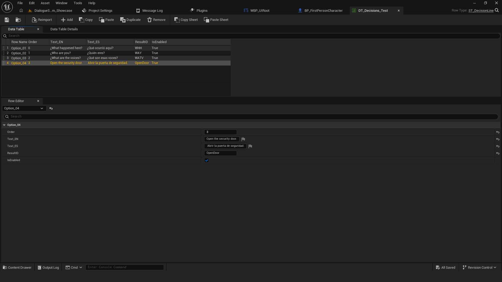
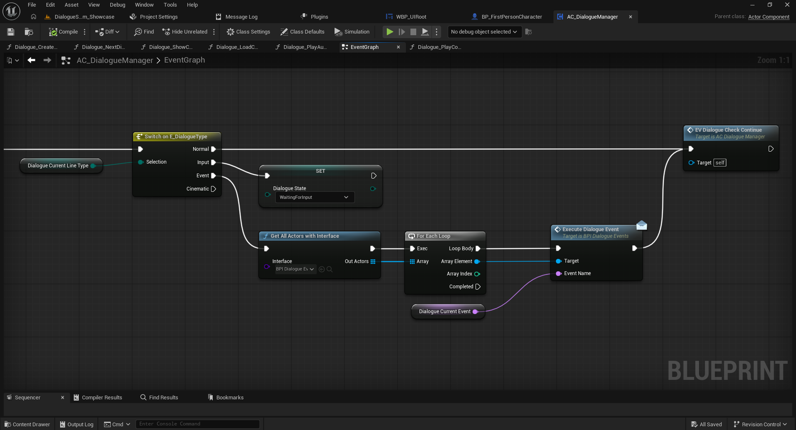
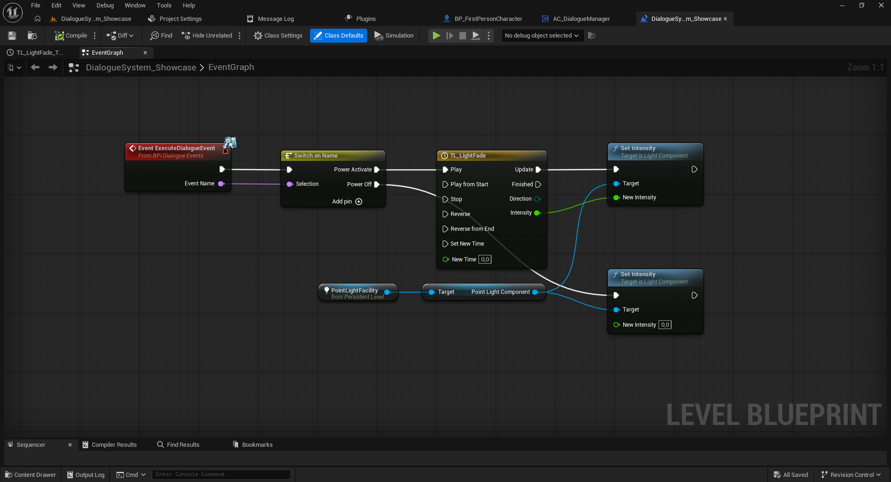
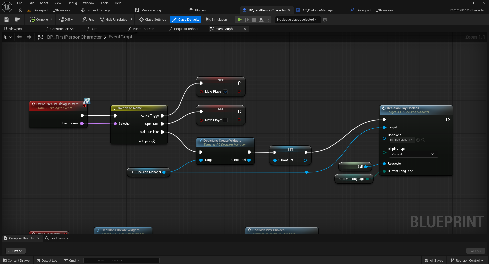

# 03 — Eventos mediante Blueprint Interfaces

[← Volver al índice](../README.md)

Los eventos permiten modificar objetos de tu juego durante una conversación sin insertar lógica particular del juego dentro de `AC_DialogueManager`.

## 1. Declarar el evento en la Data Table

En la fila correspondiente, configura el tipo de línea `Event` cuando aplique e introduce un identificador en `TriggerEvent`, por ejemplo `PowerActivate`. El texto debe coincidir con el caso que procesará el receptor.



## 2. Preparar el Blueprint receptor

1. Abre el actor que reaccionará, por ejemplo una puerta, una luz o el Blueprint del jugador.
2. Selecciona **Class Settings > Implemented Interfaces**.
3. Agrega `BPI_DialogueEvents`; compila.
4. En el Event Graph, implementa `Event ExecuteDialogueEvent`.
5. Desde `Event Name`, añade `Switch on Name` y crea el caso `PowerActivate`.
6. Conecta ese caso con tu lógica: encender luz, abrir puerta, modificar variable, etc.

## 3. ¿Cómo llega el mensaje?

Según el flujo del componente que revisamos, la implementación documentada del sistema de diálogos usa **Get All Actors with Interface** (`BPI_DialogueEvents`), recorre el resultado con **For Each Loop** y envía **Execute Dialogue Event** a cada receptor, incluyendo el nombre del evento.

```text
DT_MiConversacion (TriggerEvent: PowerActivate)
  → AC_Dialogue
  → Get All Actors with Interface (BPI_DialogueEvents)
  → For Each Loop
  → Execute Dialogue Event (Event Name)
  → Receptor: Switch on Name
  → PowerActivate → acción del juego
```

**Importante:** si más de un actor implementa la interfaz, cada uno puede recibir el mismo nombre. Filtra las acciones en cada receptor con `Switch on Name` o una comprobación equivalente.







## 4. Eventos de inicio y fin

La documentación de la arquitectura anterior describe `BPI_DialogueConversation` con `ConversationStarted()` y `ConversationFinished()`. En Full pueden utilizarse para responder al comienzo o final de una conversación (por ejemplo bloquear movimiento u ocultar HUD). **Verificar en el proyecto:** clase receptora, firma y ruta exacta de emisión tras la migración a `AC_DialogueManager`.

## 5. Relación con las decisiones

La demo Full usa un caso del `Switch on Name` denominado `Make Decision` para abrir opciones con `AC_DecisionManager`. Consulta [la guía de decisiones](04-decisiones.md).

Siguiente: [Decisiones con Common UI](04-decisiones.md).
