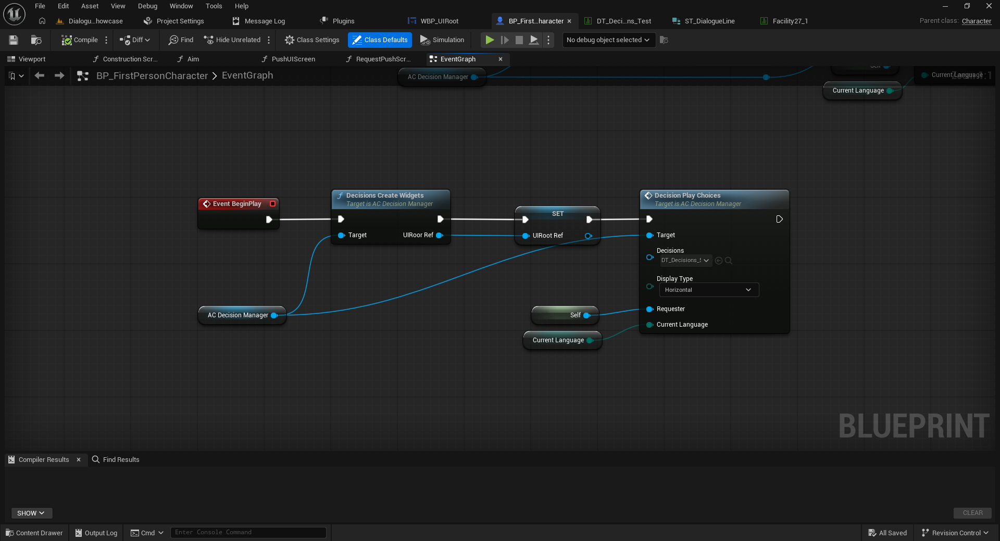
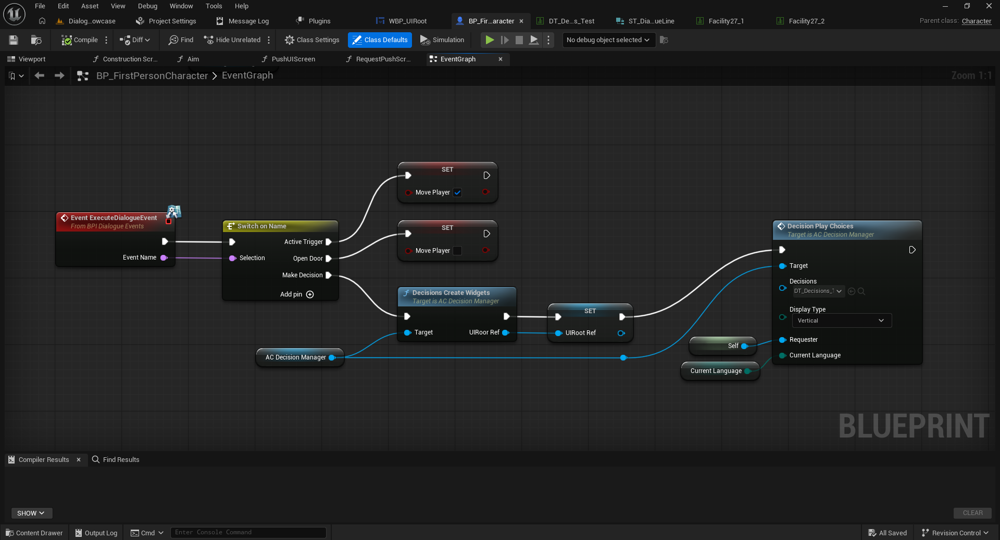
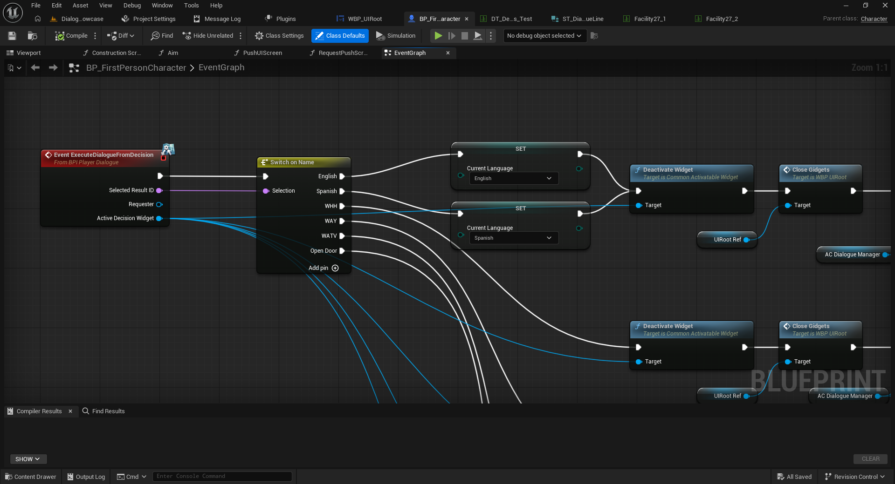
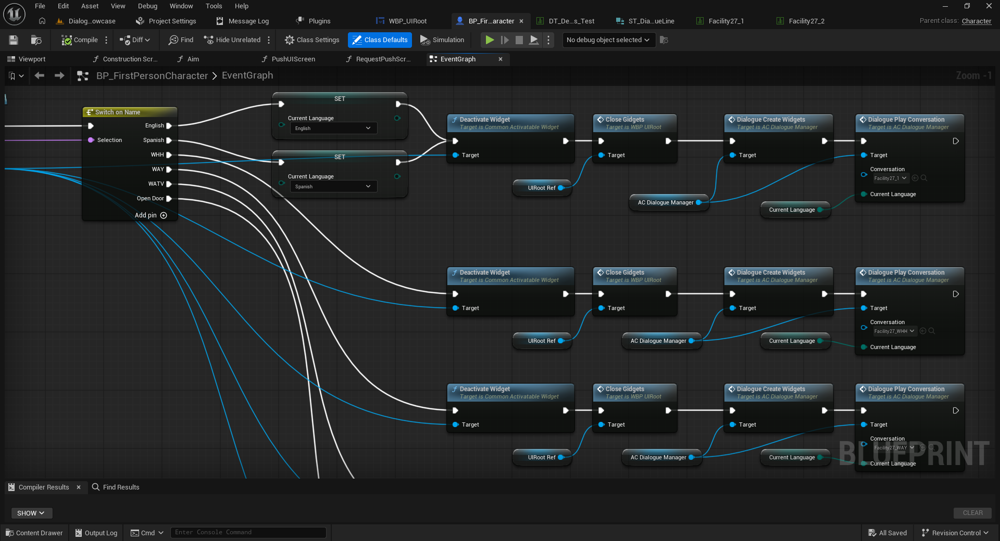
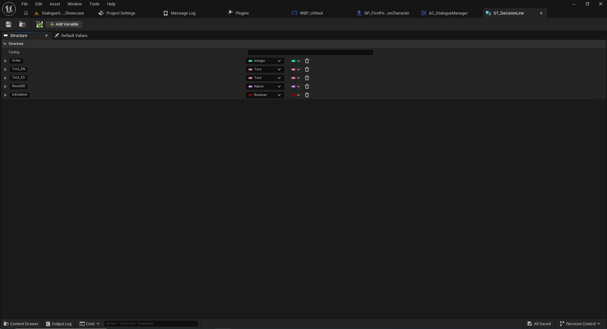
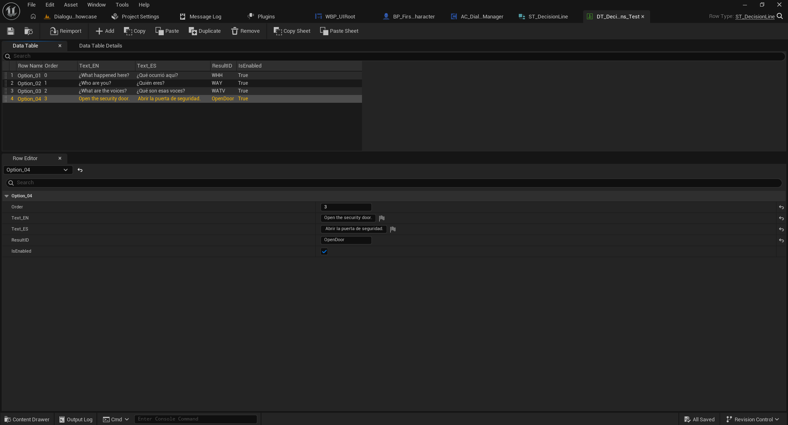
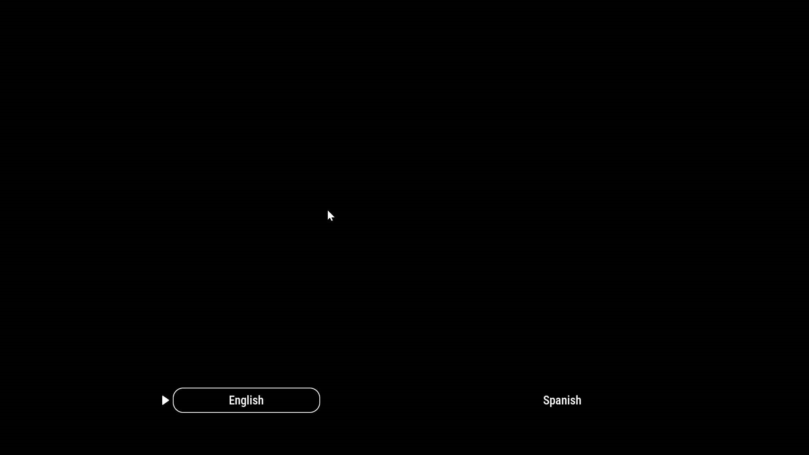
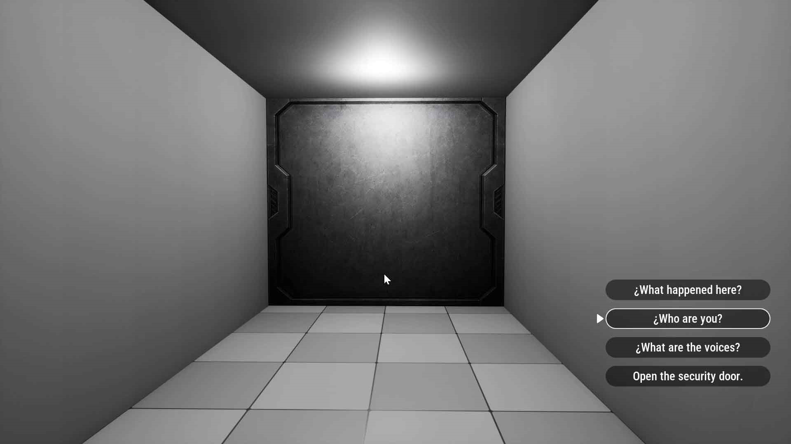

# 04 — Sistema de decisiones con Common UI (Full)

[← Volver al índice](../README.md)

La edición Full incorpora un sistema independiente de decisiones mediante el componente **`AC_DecisionManager`**, botones de **Common UI** y Data Tables de opciones. Puede iniciarse directamente desde el personaje o como respuesta a un evento del sistema de diálogos.

## 1. Requisito: activar Common UI

En Unreal Engine, ve a **Edit > Plugins**, busca **Common UI**, actívalo y reinicia el editor si se solicita.

## 2. Preparar el personaje

1. Abre el Blueprint del jugador (`BP_FirstPersonCharacter` en la demo).
2. Agrega el Actor Component `AC_DecisionManager` desde **Components > Add**.
3. Compila y guarda.
4. En el **Event Graph**, arrastra una referencia del componente para utilizarla como `Target`.

## 3. Crear los widgets e iniciar las decisiones

La primera captura muestra el flujo mínimo de prueba desde `Event BeginPlay`:

1. Desde `Event BeginPlay` ejecuta **`Decisions Create Widgets`** (`Target`: `AC_DecisionManager`).
2. Guarda el resultado `UIRoot Ref` en una variable de referencia al widget raíz (en la demo: `UIRoot Ref`).
3. Ejecuta **`Decision Play Choices`** con `AC_DecisionManager` como `Target`.
4. En el pin `Decisions`, selecciona la Data Table de opciones (la demo utiliza `DT_Decisions_Test`).
5. Selecciona `Display Type`: `Horizontal` o `Vertical` según cómo quieras presentar los botones.
6. Conecta `Requester` con el actor que debe recibir la respuesta (en el ejemplo, `Self`).
7. Conecta `Current Language` con la variable del idioma actual.

```text
Event BeginPlay
  → Decisions Create Widgets (Target: AC_DecisionManager)
  → Set UIRoot Ref (salida UIRoot Ref)
  → Decision Play Choices (Target: AC_DecisionManager)
       Decisions: DT_Decisions_Test
       Display Type: Horizontal / Vertical
       Requester: Self
       Current Language: Current Language
```



**Nota:** esta imagen representa una prueba que inicia las opciones automáticamente. En un juego real puedes abrirlas cuando ocurra una interacción o un evento de diálogo.

## 4. Mostrar decisiones desde un evento de conversación

En el ejemplo de la demo, el `BP_FirstPersonCharacter` implementa `BPI_DialogueEvents` y recibe `Event ExecuteDialogueEvent`. El pin `Event Name` entra a un `Switch on Name`. En el caso `Make Decision`, se llama a `Decisions Create Widgets`, se almacena `UIRoot Ref` y después se llama a `Decision Play Choices` con `Display Type = Vertical`.



**Importante:** los nombres de cada caso (`Make Decision`, etc.) son ejemplos de la demo. Para utilizar otros, el valor `TriggerEvent` de la fila correspondiente de la conversación debe coincidir con el caso del `Switch on Name`.

## 5. Procesar la opción elegida

La captura muestra un evento llamado **`ExecuteDialogueFromDecision`** de la interfaz `BPI_PlayerDialogue`. Entrega al receptor:

- `Selected Result ID`: identificador de la opción seleccionada.
- `Requester`: referencia al solicitante.
- `Active Decision Widget`: referencia al widget activo.

En el ejemplo, `Selected Result ID` se conecta a `Switch on Name`; los casos `English`, `Spanish`, `WHH`, `WAY`, `WATV` y `Open Door` demuestran respuestas diferentes.



Los casos `English` y `Spanish` actualizan `Current Language`. Después, el ejemplo desactiva el widget con `Deactivate Widget` y llama a `Close Gidgets` desde `WBP_UIRoot` (nombre exacto del nodo tal como aparece en la captura).



El resto de la secuencia de ejemplo crea los widgets de diálogo mediante `Dialogue Create Widgets` y llama a `Dialogue Play Conversation` sobre `AC_DialogueManager`, pasando la tabla seleccionada y `Current Language`. La llamada posterior depende de qué resultado elija el jugador.

**Advertencia:** la demo muestra `AC_DialogueManager` para este flujo, mientras que la guía de inicio simple utiliza `AC_DialogueManager`. Comprueba el nombre del componente incluido en tu paquete antes de copiar el flujo; puede haber diferencias entre la demo Full y las versiones del sistema.

## 6. Crear la Data Table de decisiones

La estructura utilizada es **`ST_DecisionLine`**. Para crear una tabla:

1. En el Content Browser selecciona **Miscellaneous → Data Table**.
2. Usa la estructura `ST_DecisionLine` y asigna un nombre, como `DT_MisDecisiones`.
3. Agrega una fila por botón y configura sus campos:

| Propiedad | Tipo | Función |
|---|---|---|
| `Order` | Integer | Orden visual de las opciones. |
| `Text_EN` | Text | Texto del botón en inglés. |
| `Text_ES` | Text | Texto del botón en español. |
| `ResultID` | Name | Identificador devuelto al seleccionar esa opción. |
| `IsEnabled` | Boolean | Permite habilitar o deshabilitar esa opción. |

**`Row Name` no es `ResultID`:** identifica la fila; `ResultID` identifica el resultado que procesará el Blueprint receptor.

En la demo `DT_Decisions_Test`, hay cuatro filas con identificadores como `WHH`, `WAY`, `WATV` y `OpenDoor`, y textos en inglés y español. Los resultados deben coincidir con las entradas de `Switch on Name` cuando proceses `Selected Result ID`.





## 7. Presentación horizontal y vertical

El parámetro `Display Type` de `Decision Play Choices` permite cambiar la disposición de los botones.





## 8. Resumen

- `AC_DecisionManager` crea y muestra las opciones.
- La Data Table controla texto, orden, resultado y estado habilitado.
- `Requester` identifica al actor que recibe el resultado.
- `BPI_PlayerDialogue` entrega `Selected Result ID` para que el juego cambie de idioma, active una acción o continúe la conversación.

Siguiente: [Rich Text](05-rich-text.md).
