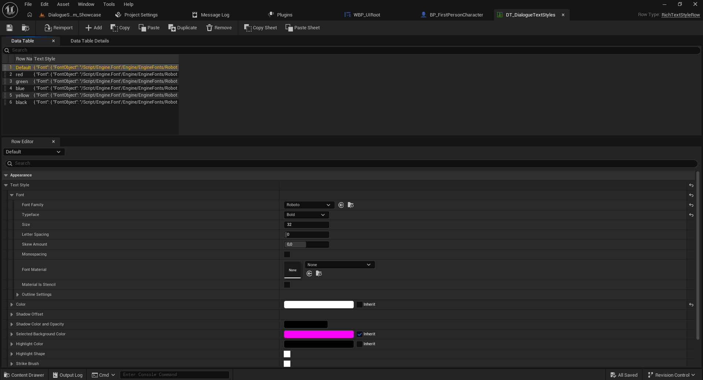
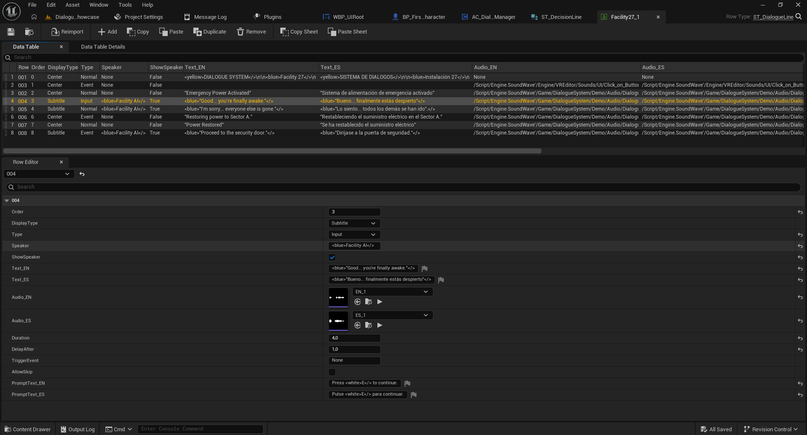
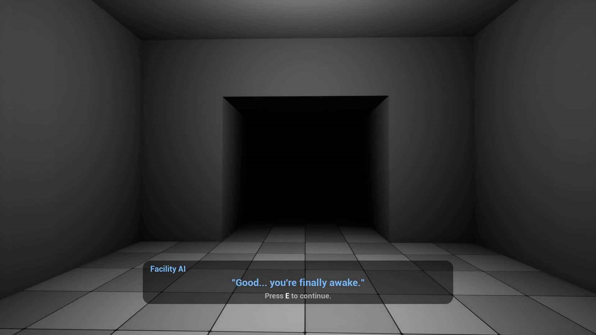

# 05 — Rich Text: palabras y frases de colores (Full)

[← Volver al índice](../README.md)

Full permite resaltar términos en una misma línea del diálogo mediante estilos de **Rich Text**.

## 1. Tabla de estilos

La demo utiliza la Data Table **`DT_DialogueTextStyles`** con filas `Default`, `red`, `green`, `blue`, `yellow` y `black`. Su estructura de fila es `RichTextStyleRow` e incluye la configuración del estilo de texto: fuente, tamaño, color, contorno y otros parámetros.

1. Abre `DT_DialogueTextStyles`.
2. Selecciona el estilo que quieras modificar.
3. Ajusta **Text Style → Font / Color** en el Row Editor.
4. Guarda la tabla.

## 2. Aplicar los estilos a las conversaciones

1. Abre una Data Table de conversación creada con `ST_DialogueLine`.
2. Edita `Text_EN` o `Text_ES` de la fila.
3. Agrega el marcado Rich Text utilizando el **nombre exacto de uno de los estilos** definidos en tu tabla.
4. Guarda los cambios y ejecuta la conversación para revisar el resultado.

**Importante:** antes de copiar un ejemplo literal de etiquetas, comprueba cómo está escrito el marcado en las líneas de ejemplo del paquete Full. El nombre de la fila de estilo y el marcado deben corresponderse.

## 3. Resultado y recomendaciones

Procura resaltar solamente palabras relevantes, asegurar contraste con el fondo y comprobar ambas traducciones. Los colores permiten enfatizar advertencias, lugares, objetivos y objetos importantes.

Siguiente: [Audio y controles](06-audio-y-controles.md).
