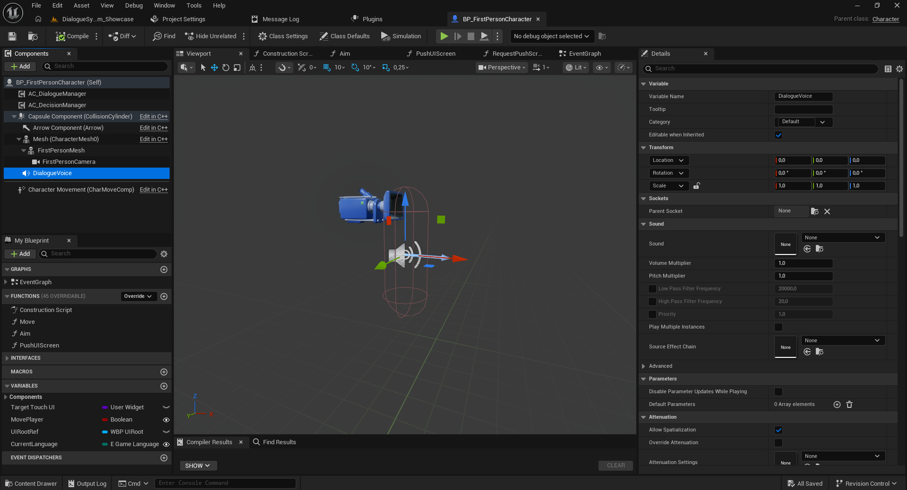
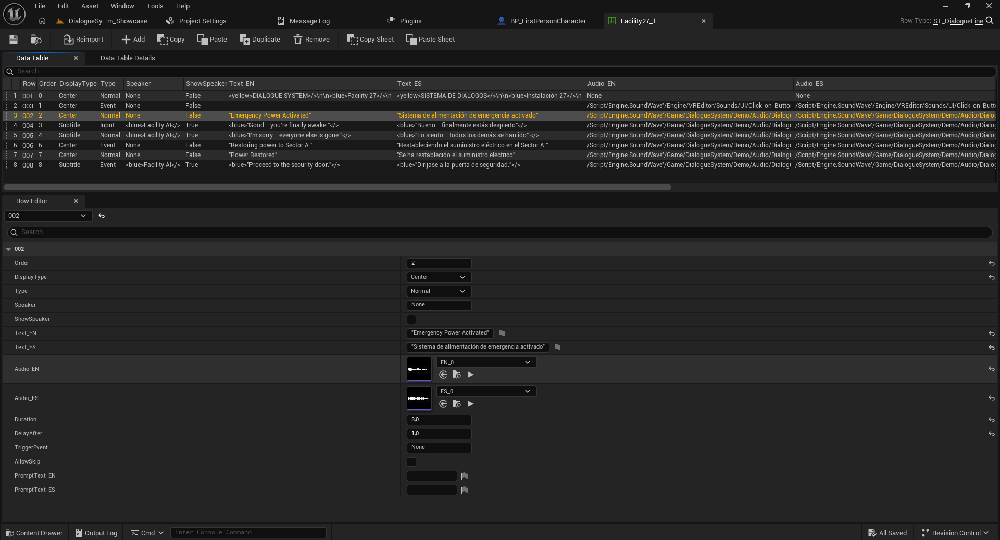
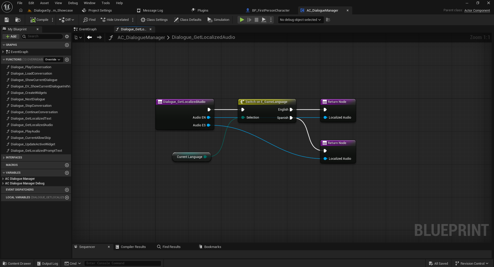
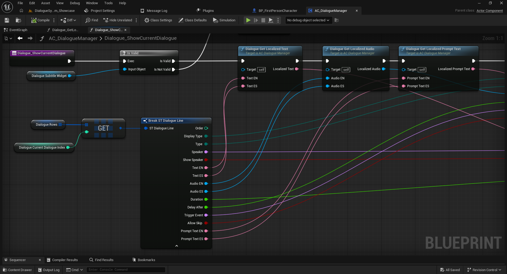
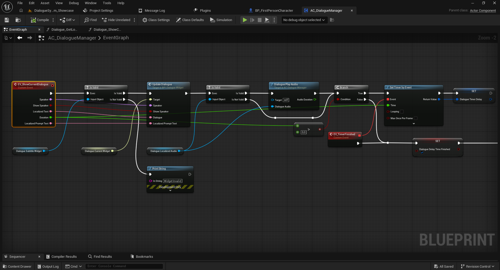
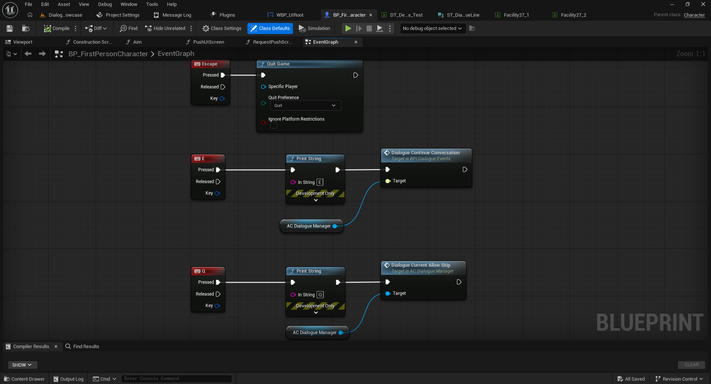

# 06 — Audio, sincronización, duración y controles

[← Volver al índice](../README.md)

## 1. Preparar el reproductor de voz

La demo incluye un componente **Audio Component** llamado `DialogueVoice` dentro de `BP_FirstPersonCharacter`. El sonido por defecto puede estar en `None`, ya que cada fila de la conversación suministra su audio localizado.

## 2. Configurar las líneas

En una Data Table de conversación `ST_DialogueLine`, las propiedades son:

- `Audio_EN` / `Audio_ES`: referencias de audio (`Sound Base`) por idioma.
- `Duration`: duración configurada de la línea.
- `DelayAfter`: pausa adicional tras la línea.
- `AllowSkip`: permite o impide omitir la línea en Full.
- `PromptText_EN` / `PromptText_ES`: instrucciones localizadas.

## 3. Selección del audio por idioma

Dentro de **`AC_DialogueManager`**, la función `Dialogue_GetLocalizedAudio` utiliza `Switch on E_GameLanguage` para devolver `Audio EN` cuando el idioma es inglés y `Audio ES` cuando es español.

En el flujo de presentación de cada línea, el manager obtiene el texto, audio y prompt localizados desde `ST_DialogueLine`; después actualiza el widget y llama a `Dialogue Play Audio`. El resultado `Audio Duration` se utiliza en la lógica de temporización junto con la duración configurada, según el estado de la línea.

**Nota técnica:** para explicar con precisión la prioridad entre `Audio Duration` y `Duration` cuando existe audio, conviene revisar la función completa `Dialogue_PlayAudio` y la conexión de `Set Timer by Event`; la captura disponible muestra el flujo parcial y no justifica una regla universal.

## 4. Control del jugador

En el proyecto de ejemplo:

- `E` ejecuta `Dialogue Continue Conversation` mediante `BPI_DialogueEvents`.
- `Q` ejecuta `Dialogue Current Allow Skip` sobre `AC_DialogueManager`.

Estas teclas se pueden reemplazar por Enhanced Input o por otros controles del proyecto.

Siguiente: [Localización e interfaces](07-localizacion-e-interfaces.md).
