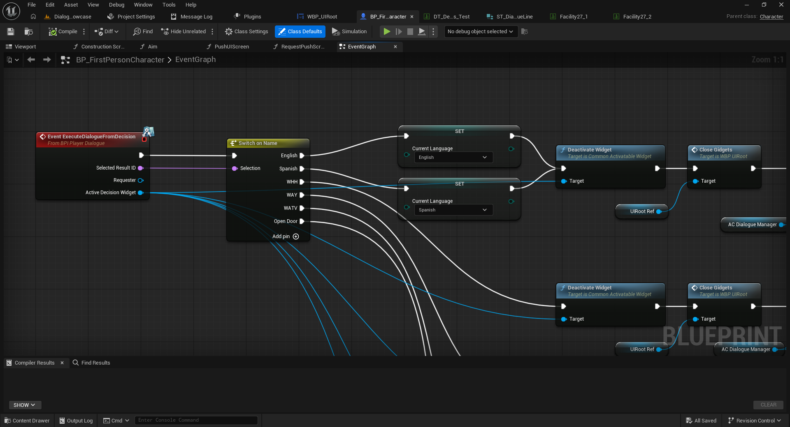
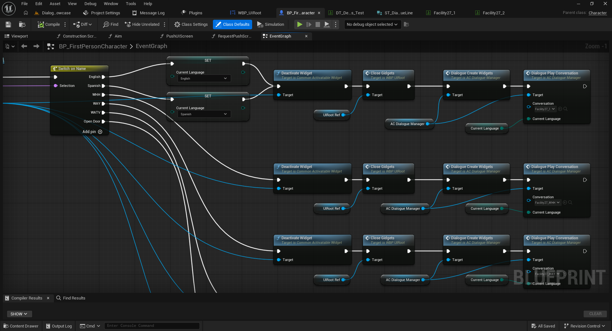
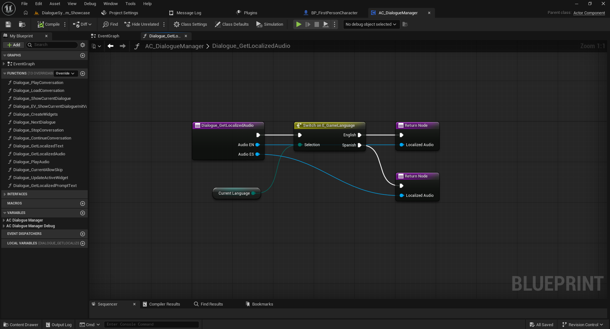
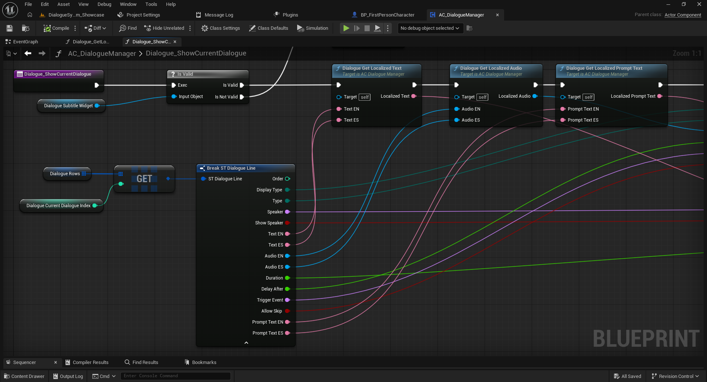

# 07 — Localización e interfaces de diálogo

[← Volver al índice](../README.md)

## 1. Localización ES / EN

Cada línea puede incluir los pares `Text_ES` / `Text_EN`, `Audio_ES` / `Audio_EN` y `PromptText_ES` / `PromptText_EN`.

En la demostración Full, el personaje utiliza la variable `Current Language` y la pasa tanto a `Decision Play Choices` como a `Dialogue Play Conversation`. El evento `ExecuteDialogueFromDecision` puede recibir los resultados `English` y `Spanish` y actualizar esa variable antes de volver a crear los widgets de diálogo. No utilices las instrucciones antiguas de GameInstance.

## 2. Interfaz de subtítulos

`DisplayType = Subtitle` muestra el texto como subtítulos en la parte inferior, de acuerdo con el widget configurado.

## 3. Interfaz centrada

`DisplayType = Center` muestra la línea en un widget centrado, útil para avisos y mensajes de escena.

Los nombres `WBP_Subtitles` y `WBP_CenterDialogue` aparecen en la documentación anterior. Verifica que sean los nombres vigentes en el paquete Full.

## 4. Nombre de personaje y mensajes

- `Speaker`: identificador del personaje.
- `ShowSpeaker`: muestra u oculta su nombre.
- `PromptText_ES` / `PromptText_EN`: mensaje de apoyo localizado.

## 5. Agregar nuevos idiomas o estilos

Ampliar los idiomas o añadir nuevos widgets requiere adaptar los datos y las rutas de selección del componente. La documentación anterior menciona `BPI_DialogueWidget`, `EDialogueDisplay` y métodos de actualización; **verifica los nombres y conexiones actuales** antes de extenderlos.

Siguiente: [Migración](08-migracion.md).
